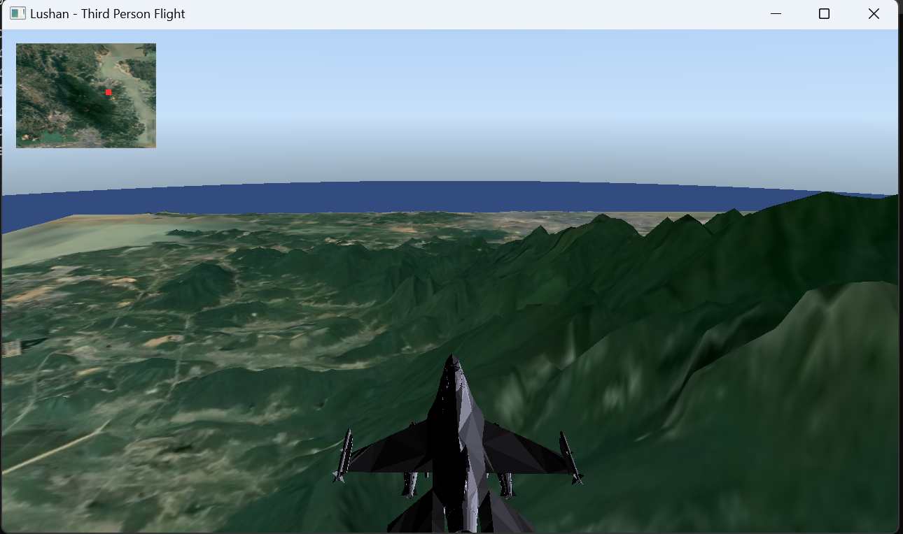
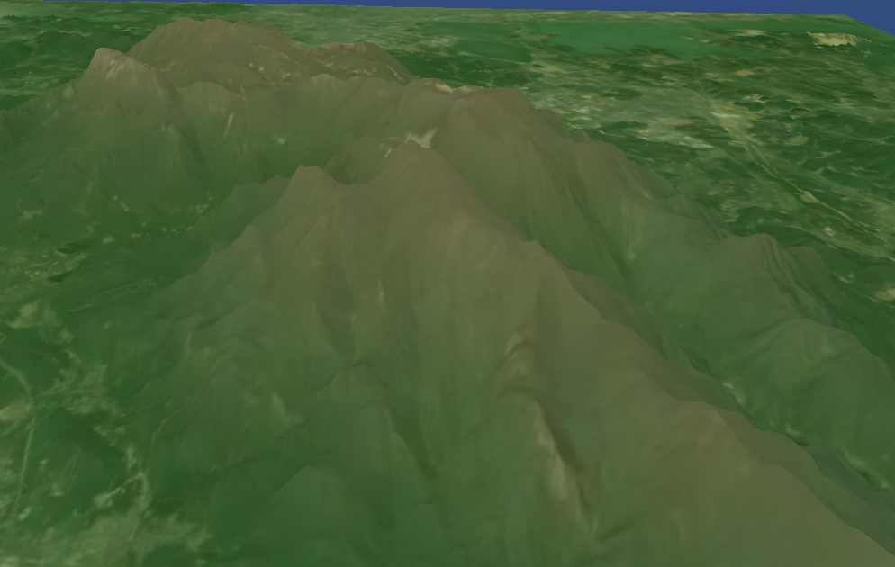
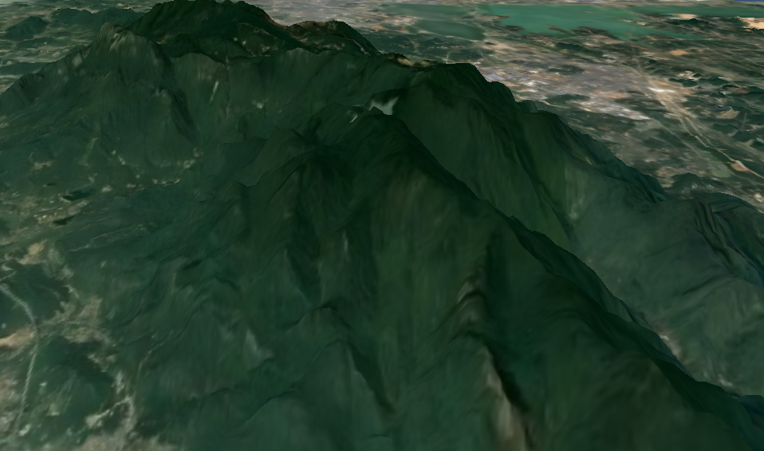
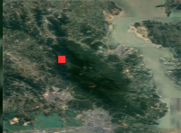
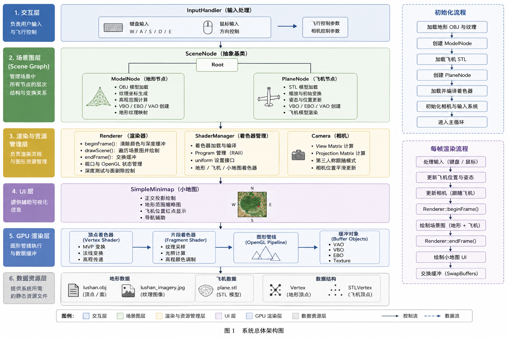

# 庐山三维地形可视化与漫游系统

**Lushan 3D Terrain Visualization and Flight Simulation System**

一个基于 C++、OpenGL 的课程设计项目：加载庐山三维地形和影像纹理，使用键盘、鼠标控制飞机漫游，并在小地图上显示当前位置。项目用于实践面向对象设计、模型与纹理加载、GLSL 着色器和实时交互。

> 本 README 依据《面向对象程序设计实践》课设报告与当前仓库代码整理。报告中的设计图和运行截图保留作展示；功能说明以当前代码为准。

## 1. 项目简介（Project Overview）

项目读取由 DEM 数据转换得到的 `lushan.obj` 地形模型，用 `lushan_imagery.jpg` 为地形表面贴图。程序还加载 STL 飞机模型，绘制天空穹顶，并用 `lushan_map.jpg` 显示小地图。主循环逐帧更新飞机位置、相机视角和小地图标记。

## 2. 项目演示（Screenshots）

以下图片直接提取自课设报告，展示的是报告记录时的运行效果，不代表本仓库已重新完成运行测试。

### 2.1 系统主界面与飞机漫游

### 2.2 地形影像与高程配色

| 高程配色叠加影像 | 原始影像纹理 |
| --- | --- |
|  |  |

### 2.3 实时小地图

## 3. 核心功能（Features）

### 3.1 三维地形加载与渲染

`ModelNode` 读取 OBJ 顶点和三角形面索引，将原始模型的 Z 坐标作为场景高程 Y，按地形 X/Z 范围生成纹理坐标，再将顶点和索引上传至 OpenGL 缓冲区。当前加载器针对本项目的三角面 OBJ 文件编写，并非完整的通用 OBJ 解析器。

### 3.2 两种地形显示效果

默认模式将影像纹理与按高程计算的颜色混合；另一模式直接显示影像纹理。着色器使用地形最低、最高高程计算颜色渐变。程序设置 `E` 键切换模式；**当前按键状态代码只允许首次按下生效，松开后再次按下无法切回**，见“当前限制”。

### 3.3 飞机漫游与相机跟随

`PlaneNode` 加载 `assets/plane.STL`。主循环读取 WASD 和鼠标位移，更新飞机位置、偏航角、俯仰角，并据此更新相机。相机位置随飞机变化；当前代码中的相机偏移位于飞行方向的前上方，因此尚不能保证呈现报告所述的“飞机后上方第三人称视角”。

### 3.4 实时小地图与天空

`SimpleMinimap` 将飞机的 X/Z 世界坐标映射到左上角的小地图，并以红点标出位置。当前实现**没有绘制航向射线**。天空由 `SkyDomeNode` 的顶点颜色和着色器绘制，不读取 `assets/sky.jpg`。

## 4. 技术架构（Architecture）

### 4.1 主要类与模块

| 类或模块 | 当前职责 |
| --- | --- |
| `SceneNode` | 场景节点基类，保存父子节点与局部变换 |
| `ModelNode` | 地形 OBJ 解析、纹理加载和绘制 |
| `PlaneNode`、`STLLoader` | 飞机模型加载与绘制 |
| `SkyDomeNode` | 天空穹顶网格与颜色 |
| `Camera` | 视图矩阵、投影矩阵和相机方向 |
| `Renderer`、`ShaderManager` | 渲染流程与 GLSL 着色器管理 |
| `SimpleMinimap` | 小地图底图与位置标记 |
| `InputHandler` | 独立的输入处理类；当前主程序直接读取 GLFW 输入 |

### 4.2 报告中的系统架构

图中展示了课程设计的分层思路。当前主程序直接创建并逐个绘制地形、飞机和天空节点，尚未通过根节点遍历整棵场景树；输入也直接在主循环中处理。阅读代码时请以现有实现为准。

### 4.3 核心数据结构

`std::vector` 保存模型顶点与索引；VAO、VBO、EBO 保存 GPU 绘制所需的数据。地形加载器目前为每个三角面追加三个顶点，虽然使用了 EBO，但**没有跨面复用顶点**。场景节点类提供父子关系和变换组合接口，为后续层次化组织场景保留了基础。

## 5. 技术栈（Tech Stack）

| 技术 | 用途 |
| --- | --- |
| C++、Visual Studio 2022 | 程序开发与构建 |
| OpenGL 3.3、GLSL | 三维绘制与着色 |
| GLFW 3.4.0 | 窗口、键盘与鼠标输入 |
| GLM 1.0.3 | 向量、矩阵和空间变换 |
| GLAD | 加载 OpenGL 函数 |
| stb_image | 读取 JPG 纹理 |

## 6. 项目资源（Project Assets）

以下路径相对于仓库根目录，也是程序当前使用的加载路径：

| 文件 | 用途 |
| --- | --- |
| `lushan.obj` | 庐山地形模型 |
| `lushan_imagery.jpg` | 地形纹理 |
| `lushan_map.jpg` | 小地图底图 |
| `assets/plane.STL` | 飞机模型，文件名大小写与代码一致 |
| `terrain.vert`、`terrain.frag` | 地形着色器 |
| `plane.vert`、`plane.frag` | 飞机着色器 |
| `sky_dome.vert`、`sky_dome.frag` | 天空着色器 |

`assets/sky.jpg` 和 `heightmap.png` 已保留在仓库，但当前程序不读取。当前两张庐山 JPG 文件内容相同，代码分别引用这两个文件名，因此运行时仍需保留。README 中的 `screenshots/` 图片仅用于展示。

## 7. 环境配置与运行（Build & Run）

课设报告记录的开发测试环境为 Windows 10、Visual Studio 2022。运行需要支持 OpenGL 3.3 的显卡驱动；本仓库未在其他系统上验证。

1. 安装 Visual Studio 2022，并启用“使用 C++ 的桌面开发”组件。
2. 打开仓库根目录的 `三维地形可视化与漫游系统.sln`。
3. 若提示 GLFW、GLM 缺失，在解决方案中执行“还原 NuGet 程序包”。版本记录在 `packages.config`；GLAD 和 stb_image 源码已包含在仓库。
4. 当前 `.vcxproj` 的 GLAD 包含目录写有作者电脑的绝对路径。首次在其他电脑构建时，将项目属性中 **VC++ 目录 → 包含目录** 的该路径改为当前仓库的 `include` 目录。
5. 选择 `x64` 配置生成项目。程序通过相对路径读取模型、纹理和着色器；在 **项目属性 → 调试 → 工作目录** 中设置为 `$(ProjectDir)`，然后启动。若运行提示资源加载失败，先检查工作目录和上表中的文件路径。

无需把资源逐一复制到 exe 所在目录：只要运行时工作目录是仓库根目录，当前相对路径即可找到它们。

## 8. 程序操作说明（Controls）

| 输入 | 作用 |
| --- | --- |
| `W` / `S` | 沿当前飞行方向前进 / 后退 |
| `A` / `D` | 向左 / 向右平移 |
| 鼠标左右移动 | 调整偏航角 |
| 鼠标上下移动 | 调整俯仰角，范围限制为约 ±80° |
| `E` | 切换地形显示效果；当前版本仅首次按下有效 |

程序启动时会捕获鼠标。关闭窗口即可退出。

## 9. 测试记录（Testing）

课设报告记录了地形模型加载、纹理显示、飞机移动、鼠标转向与小地图位置更新的运行结果；报告中的约 60 FPS 是当时测试环境的观察值，**不是本仓库当前版本的性能保证**。

当前仓库中的 `lushan.obj` 经文件检查包含 **90,000 条顶点记录和 178,802 个三角面**，面索引均在有效范围内。报告提及的“约 30 万顶点”与当前文件不一致，因此这里以实际文件为准。此次 README 更新未在本机重新编译或运行程序。

## 10. 后续改进方向（Future Work）

1. 修复 `E` 键状态判断，使两种显示效果可反复切换。
2. 调整相机偏移至飞机后上方，并验证飞机模型始终处于画面中。
3. 为小地图增加航向指示；把输入处理和场景树接口接入主循环。
4. 将项目中的绝对包含路径改为相对路径，验证全新克隆后的构建流程。
5. 扩展模型加载器对 OBJ 材质、更多面格式和其他三维格式的支持。

## 11. 资源来源与致谢（Acknowledgements）

本项目是《面向对象程序设计实践》课程设计作品。项目使用 GLFW、GLM、GLAD 和 stb_image，并参考 OpenGL 技术资料。课设报告说明飞机 STL 模型参考了 GitHub 开源资源，开发过程中也使用 AI 工具辅助环境配置和问题排查。

第三方模型与影像的具体来源、许可证信息尚未在仓库中列明；若计划将仓库作为公开作品展示，建议补充原始链接及授权说明。
